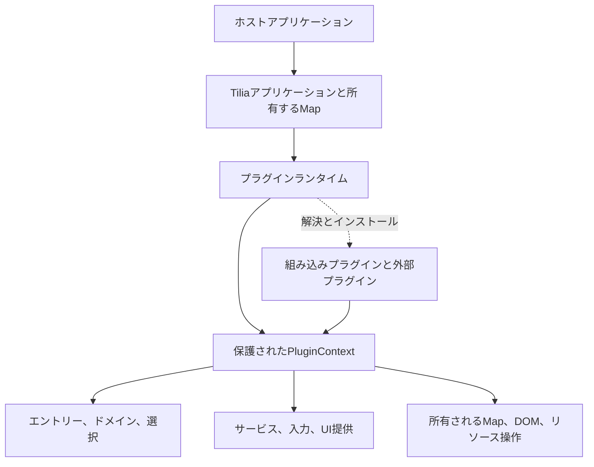
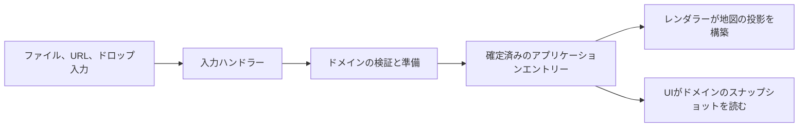

[English](ARCHITECTURE.md)

# Tiliaのアーキテクチャ

Tiliaは、アプリケーションランタイムと任意のプラグインを備えた、組み込み可能な地図ライブラリです。このドキュメントでは現在の設計として、どのコンポーネントがデータを所有するか、任意の機能がどのように統合されるか、ビュー、プラグイン、アプリケーションが終了するときに何が起こるかを説明します。Tiliaを組み込む開発者や、プラグインで拡張する開発者を対象としています。

動作する例は[README](README.ja.md)と[Tiliaプラグインガイド](PLUGINS.ja.md)から始めてください。プラグインの実装パターンと正確なアプリケーション呼び出しは、[Tiliaプラグインの開発](PLUGIN-OPERATION.ja.md)と[Tilia APIリファレンス](API.ja.md)を参照してください。以下に出てくる内部コンポーネント名は責務を説明するもので、追加の公開APIではありません。

## 設計の根拠

Tiliaは、小さな組み込み地図から、ビューアーや編集ツールまでを対象にしています。これらのアプリケーションは、形式、コントロール、可視化の組み合わせがそれぞれ異なります。このアーキテクチャは、アプリケーションが使う機能を選べるようにしながら、一貫したデータとリソースの寿命を共有できるようにします。

中心となる設計原則は次のとおりです。

> コアは仕組み（mechanism）を所有します。プラグインはドメイン固有のポリシーと振る舞いを所有します。

汎用の仕組みは、エントリーの識別、選択、依存順序、リソースの所有、公開を管理します。GPX文書やPhotoの意味はドメインプラグインが与え、その入力ハンドラーがファイルの読み方を、レンダラーが表示方法を知っています。汎用のエントリー基盤やUI基盤は、カメラのメタデータやトラックのジオメトリを解釈する必要がありません。

この原則から、次の方針が導かれます。

- **任意の機能は任意のままにします。** GPXだけのアプリケーションに、JPEGハンドラーのEXIFパーサーは不要です。カタログは遅延ローダーを公開し、どの機能を選ぶかによって読み込まれる実装が決まります。
- **データが正です。** 地図レイヤーとUIは、確定済みデータの差し替え可能なビューです。描画の失敗や削除によって、そのデータが消えることはありません。
- **所有権は明示的です。** すべての登録、リスナー、レイヤー、タイマー、リクエスト、一時的なビューに所有者がいます。初期化には、部分的に失敗した場合を含む後処理の計画が含まれます。
- **拡張の契約は用途ごとに具体的に保ちます。** サービス、ドメイン、入力、UI提供は、それぞれ異なる問題を解決します。プラグインは、万能のレジストリーやグローバルなイベントバスではなく、これらの契約を通じて統合します。
- **抽象化は具体的な地図の要件に応えます。** 共有の仕組みは、GPX、Photo、編集セッション、入力コントロールといった用途によって正当化されます。形式固有の操作は、汎用的な名前を付けただけでは汎用になりません。
- **組み込みプラグインと外部プラグインは同じモデルに従います。** 組み込みプラグインも、保護されたコンテキスト、段階的な登録、所有されたリソースを使います。アプリケーションの構成とライフサイクルの調整は、引き続き基盤の責務です。

その結果、Tiliaの地図ユースケースに向けたプラグインシステムになっています。パッケージの探索、依存バージョンの解決、汎用スケジューラー、JavaScriptのセキュリティサンドボックスは提供しません。公開APIと設定は、引き続きプロジェクトの初期アルファ版の互換性方針に従います。

## アプリケーションとプラグインの境界

ホストコードは`createDefaultTiliaApp(container, options)`でアプリケーションを生成します。アプリケーションは、固有のLeaflet Map、意味上の状態、レジストリー、アプリケーション基盤を所有します。ホストはコンテナーを渡し、プラグインの設定を選びます。

プラグインランタイムは、設定された定義を解決し、必須依存を計画して、各プラグインの`setup(context, options)`を呼びます。PluginContextは個々の仕組みへの保護されたアクセスを提供し、各プラグインにリソース用のScopeを与えます。

図は構成とアクセスの関係を示すもので、静的なimportグラフではありません。

構成層がローダーを供給します。汎用の意味上の仕組みや所有の仕組みは、データを解釈するために任意のプラグイン実装をimportしません。プラグインは、他のプラグインの非公開の実装ではなく、サポートされた契約と共有の契約キーに依存します。

`app.map`とプラグインの高度なLeafletアクセスは、アプリケーションが所有するMapへの借用アクセスです。所有権の移転や、他のレンダラーの非公開レイヤーへのアクセス権を与えるものではありません。外部Mapの注入には対応していません。別途エクスポートされる`createBaseMap`ユーティリティは、アプリケーションの生成とは独立しています。

## 機能内での役割の分離

一つの機能は、責務の異なる複数のプラグインで構成できます。

| 役割 | 責務 | 例 |
| --- | --- | --- |
| ドメイン | 意味上のデータを検証して所有し、コマンド、クエリ、選択参照を公開する | `tilia-gpx-domain`, `tilia-photo-domain` |
| 入力ハンドラー | ファイルを認識して解析し、ドメインのエントリーを作る | `tilia-gpx-input`, `tilia-jpeg-input` |
| レンダラー | ドメインのスナップショットを地図に投影する | `tilia-gpx-renderer`, `tilia-photo-renderer` |
| UI提供プラグイン | 形式固有のレイヤー行、ポップアップの内容、設定を提供する | `tilia-gpx-ui`, `tilia-photo-ui` |
| ホストまたはプレゼンター | 提供された内容を配置する、または現在の選択を表示する | `tilia-layers`, `tilia-settings`, `tilia-map-selection-presenter` |
| ツールまたはオーバーレイ | ドメインデータを使いながら、独立した操作・表示のリソースを所有する | Track Editor, route search, Milestone |

この分離により、地図レンダラーがなくてもデータは存在でき、ビューアーのコントロールがなくてもファイルハンドラーは動作し、元のビューが変わってもエディターは自分のセッションを保てます。一つの役割をインストールしても、他の役割がすべて自動でインストールされるわけではありません。具体的な組み合わせは[プラグインガイド](PLUGINS.ja.md#choosing-plugins)を参照してください。

背景地図は別の境界にあります。登録された定義、選択中のタイルレイヤー、セレクターは地図基盤であり、ドメインのエントリーでも意味上の選択対象でもありません。ただし、所有される登録とリソースの寿命には従います。

## 依存と型付き拡張

`requires`は、プラグインが動作する前にインストールされていなければならず、その寿命の間は利用可能であり続ける必要があるプラグインIDを宣言します。ランタイムは到達可能な依存グラフを検証し、定義の欠落や循環を拒否します。既知の依存先が先にインストールされ、有効な依存先は再利用されます。IDからパッケージやパスを自動で探索することはありません。

依存の宣言は、呼び出し可能なサービス、意味上のドメイン、UI提供とは別のものです。

| 仕組み | 意味 |
| --- | --- |
| 依存 | プラグインが利用可能であることと、インストール順序 |
| サービス | 型付きサービスキーごとに有効なプロバイダーが一つだけの、呼び出し可能な契約 |
| ドメイン | ドメインキーごとに有効なプロバイダーが一つだけの、意味上の契約 |
| 入力 | 複数ある、ファイルの認識・処理の登録の一つ |
| 提供 | 特定のUIホスト向けに所有されたコンテンツまたは振る舞い |
| 購読 | 型付きの一つのサブシステムを監視する、Scopeが所有するオブザーバー |
| リソース | 直接、または共有マネージャーのリースを通じて所有される、具体的な作用 |

型付きキーは、プラグインIDとは独立に契約を識別します。プロバイダーと利用側は、エクスポートされた同じキーオブジェクトを共有します。必須の統合には必須依存と必須の検索を使います。任意の統合には、保護された任意アクセスと対象を絞った利用可能性の購読、またはホストを待てる提供を使います。

有効な依存元が必要としている間は、依存先を削除できません。依存元を削除しても、その依存先が自動でアンインストールされることはなく、正常にインストールされた依存先は、後続の依存元が失敗しても残ります。自動でインストールされる依存先には標準のオプションが使われます。必要な場合は、先に依存先を明示的に設定してください。これらのインストールの詳細は[プラグイン開発](PLUGIN-OPERATIONS.ja.md#2-install-the-plugin)で説明しています。

## インストールと公開

プラグインのインストールごとに、それぞれ固有の公開境界があります。

1. 依存関係を計画した後で、実装を解決する。
2. Scopeを作成し、PluginContextを作成する。
3. setupを実行し、登録を段階的に準備して、直ちに生じる物理的な作用を所有する。
4. 後処理の戻り値を検証し、登録のバッチを事前検査する。
5. 登録をコミットし、プラグインを有効にする。
6. コミット後の通知とコールバックを配信する。

他のプラグインが、公開途中のレジストリー提供を観測することはありません。リスナー、スタイル、DOMはsetup中に取得されることがあるため、コミット前であっても、それらの後処理はすでに所有されている必要があります。setupまたはコミットが失敗すると、そのプラグインの作用はロールバックされます。ただし、依存グラフ全体や外部の任意の作用にわたるトランザクションは作りません。ドメインを通じてすでにコミットされたアプリケーションのエントリーには固有の公開境界があり、後のsetup失敗によって自動で削除されることはありません。

コミット後の通知の失敗は分離され、コミット済みの登録を取り消しません。`lifecycle.afterCommit`は、プラグインが有効になった後にだけ処理を開始します。そのコールバックはvoidを返し、開始した非同期処理には別途、所有と監視が必要です。

同じプラグインへの同時リクエストはインストールを共有し、ライフサイクルの変更は直列化されます。インストールと削除はホストコードが指示します。プラグインは、自身のsetupや後処理から、アプリケーション／ランタイムのインストール、削除、破棄を呼んではいけません。

## 意味上の状態とエントリー

内部のエントリーストアは、保護されたファサードを通じて、アプリケーションが所有するエントリーを管理します。汎用のエントリーのスナップショットには、`id`、その`domain`キー、エントリー全体の`visible`状態が含まれます。ラベル、ジオメトリ、メタデータ、設定、派生値は、汎用のエントリー項目ではなくドメインのデータです。

エントリーIDは不透明で、一つのアプリケーション内でのみ有効であり、一度予約されたら再利用されません。ドメインとの関連付けは変わりません。同じドメイン内でデータを更新してもエントリーの識別は保たれます。編集したコピーの作成やルートのインポートでは、新しいエントリーが作られます。

ドメインAPIは、不変のスナップショットと明示的なコマンドを公開します。リビジョンの検証により、読み取った後に変化したデータへコマンドが適用されることを防ぎます。GPXの子要素の表示・スタイルやPhotoの時刻解釈など、ドメインが所有する変更は、意味上のリビジョンを進めることがあります。エントリー全体の汎用の表示切り替えは別のもので、そのリビジョンを進めません。

作成中のものも、コミット済みのエントリーも、すべて、対応する正確なドメインプロバイダーのリースを保持します。このリースは、通常のサービス利用側ではなくエントリーストアが管理します。リースが残っている間は、プロバイダーの明示的な削除は拒否されます。これにより、永続するエントリーが、自身を解釈・破棄するのに必要な実装を失うことを防ぎます。

作成者は、コミット済みエントリーの寿命の所有者ではありません。入力操作や編集セッションが終了しても、その成功した結果はアプリケーションに残り続けることがあります。

### 作成と入力

ファイルピッカー、URL、クエリ、ドロップのプラグインは、トランスポート（入力の経路）です。インストールされた入力ハンドラーがファイルを要求し、振り分けでは、優先度が最も高い唯一の要求が選ばれ、同順位の場合は拒否されます。検出用メタデータにより、入力コントロールは、パーサーを知らなくても、対応する拡張子とMIMEタイプを提示できます。

入力の呼び出しは、一時的な読み取りとキャンセルを所有します。ドメインの作成では、エントリーを公開する直前に、呼び出し元、宛先、プロバイダー、キャンセル権限を確認します。コミット前のキャンセルは公開を阻止しますが、コミット後のキャンセルは、アプリケーションが所有するエントリーをロールバックしません。振り分けは、拒否されたインポートがデータを一切作っていないと約束するのではなく、ハンドラーの結果と後処理のエラーをそのまま保持します。

描画は意味上のコミットの後に始まり、コミットの条件ではありません。したがって、描画が失敗しても、有効で未描画のエントリーが残り、クエリ、エクスポート、後からのレンダラーのインストールに利用できます。

### 更新と削除

ドメインのコマンドは、新しいスナップショットを準備して検証し、意味上の状態とリビジョンをコミットし、描画が追いつく前に選択を調整します。意味上のコミット前に失敗した場合は、以前の状態がそのまま残ります。コミット後の描画や後処理の失敗によって、確定済みの変更が取り消されることはありません。

削除では、まずエントリーを論理的に利用不可にし、その選択と表示の権限を無効にします。その後、描画、エントリーに結び付いたオーバーレイ、ドメインのリソースを閉じようと試み、それらの試行の後で最終的な削除通知を公開します。プロバイダーのリースは、必要な後処理が成功した場合にだけ解放されます。公開の検索ではもうエントリーを見つけられないため、後処理は保持しておいたハンドルを使います。

後処理が失敗しても、エントリーは復元されません。残った義務とそのプロバイダーのリースは、許可された後処理の試行のために追跡されます。`entries.clear()`は挿入の逆順にエントリーを削除し、失敗後も続行し、通知をまとめて送ります。全か無かのロールバックトランザクションではありません。

## 描画と現行性

任意のプライマリーレンダラーは、ドメインのスナップショットを解釈して、破棄可能な地図の投影を作ります。有効なプライマリーレンダラーは、ドメインの契約ごとに最大一つです。これを削除すると投影とインタラクションは取り下げられますが、意味上のエントリーは残ります。再インストールすると、現在のスナップショットから構築し直します。

内部では、アプリケーションが所有する描画コーディネーターが、エントリーコントローラーと、有効なレンダラーが構築した世代を管理します。世代は、自身のレイヤー、バインディング、ペインのリース、その他のリソースを、投影先が所有する専用の寿命の中で所有します。世代が現行として有効かどうかは、元の意味上のリビジョン、レンダラーの登録、世代トークン、エントリー／Scopeの権限によって決まります。

置き換えでは、レンダラーが候補を準備し、現在の状態に照らして検証し、前の世代を無効にしながら候補を有効にします。利用側が、構築途中の世代を現行のものとして受け取ることはありません。有効化前の失敗では候補が破棄されます。有効化後に古い世代の後処理が失敗しても、新しい世代はロールバックされません。

データがすでに先へ進んでいる場合、古い世代は、操作できない視覚上の代替表示として残るか、非表示になるだけです。現行の意味上のインタラクションや表示ハンドルを提供することはできません。描画状態は`unavailable`、`building`、`active`、`failed`を区別し、利用可否はエントリーの表示状態とは別です。

プレゼンターは、制御された表示ハンドルを通じて、アンカー、範囲、ハイライトを解決します。ハンドルの`isCurrent()`と`signal`が、その権限を表します。一度無効になったハンドルは二度と復活せず、表示を再開するには新たに解決し直す必要があります。これにより、ポップアップや標高マーカーは、レンダラーの生のレイヤーにアクセスせずに、古い投影の使用をやめられます。

## 選択、インタラクション、表示

グローバルな選択は、選択なし、または一つの不変の意味上の参照（エントリーID、ドメインキー、ドメインが検証した参照）のいずれかです。Leafletのレイヤー、ポップアップ、DOMノード、チャートのホバー状態、エディターの複数選択は含みません。呼び出し側は、該当するドメインの選択APIから選択候補を取得します。

物理的なインタラクションは、地図やUIのイベントを意味上の意図に変換します。バインディングには、明示的な寿命と優先順位（モーダル、次にオブジェクト、次に背景）があります。古いイベントが、古い世代やScopeを通じて権限を得ることはありません。

選択と地図上の表示は、寿命が異なります。

- エントリーを非表示にする、またはそのレンダラーを削除すると、表示は抑制されますが、本質的に意味上の選択が解除されるわけではありません。
- ポップアップを閉じても、標準では選択は解除されません。
- エントリーの削除や、選択中のドメイン対象の無効化では、選択が解除または調整されます。
- レンダラーの世代を置き換えると、表示は再解決されます。Leafletのオブジェクトの同一性は、意味上の同一性ではありません。

表示にも、別々の層があります。エントリー全体の表示、ドメインの子要素／カテゴリーの設定、現在のレンダラーの利用可否、一時的な表示の抑制です。エディターによる抑制は、ユーザーの設定を上書きせず、既存の表示状態と合成されます。抑制を解除すると、現在の設定に従います。

## UI、オーバーレイ、セッション状態

UIホストは、配置、レイアウト、順序、外側のコンテナー、マウントの寿命を所有します。提供側は、割り当てられたサブツリー内の振る舞いとリソースを所有します。限定された提供により、ツールバー項目、ドメインのレイヤー行、ポップアップの内容、設定を提供します。順序は、インストールのタイミングではなく、ホストが定義するグループ、順位、安定したIDで決まります。

視覚上のホストが存在しなくても、提供は登録されたままにできます。ホストは、自身の寿命が終わると、マウントされたリソースを閉じます。任意の提供側は、適切なホストが利用可能になると、再び表示されることがあります。ホストプラグインを削除できるかどうかは、引き続き必須のプラグイン依存で決まります。汎用のレイヤーコントロールは、形式固有の行の提供がない場合でも、表示／削除の操作と、ドメイン／IDによるフォールバックを保持します。

パネルの状態、ポップアップの表示、フォーム入力、ホバー、エディターの点選択は、ローカルなUI／セッション状態です。これらが、正であるエントリーデータやグローバルな意味上の選択に置き換わることはありません。マウントやポップアップが失敗しても、その意味上の状態は損なわれません。

プラグインのオーバーレイは、ドメインのスナップショットを読み、独立したレイヤーを所有します。Milestoneのラベルや標高のハイライトが、GPXレンダラーのポリラインを変更することはありません。エントリーに結び付くオーバーレイは、子の寿命をエントリーの削除に結び付けられます。セッションのオーバーレイは、代わりにエディターやリクエストの寿命に従えます。

地図のリソースは、背景地図、ジオメトリ、マーカー、オーバーレイ、選択、モーダル／エディターの表示のための順序付きの帯域を使い、ポップアップとシェルUIの下に置かれます。所有された非公開のペインにより、プラグイン間でz-indexを無秩序に競い合うことなく、局所的な配置ができます。現在のエディターで、外部ベンダーのライブラリが生成する点・中点のマーカーとドラッグ補助要素は、公開オプションで必要な帯域を指定できない場合、標準の配置のままです。これは、プラグインのリソース全般に対する例外を定めるものではありません。

`plugins/x-track-editor/vendor/` に同梱された `PartiallyEditablePolyline` のJavaScriptとCSSは、Tilia内で直接変更してはいけません。Tilia固有の動作は、ライブラリの公開APIを使ってエディターの統合コードに実装します。

### 独立した寿命の例

| 機能 | 永続的な状態 | 一時的な状態 |
| --- | --- | --- |
| JPEG入力 | メタデータと保存済みの位置を持つPhotoエントリー | EXIFの解析、入力の呼び出し |
| Photoの描画 | ドメインデータと保存済みの推定結果は、GPXの変更後も残る | マーカー、ポップアップ／ハイライトのリソース |
| Track Editor | 元のエントリー。Save Copyで新しいエントリーを作成 | 独立した下書き、編集マーカー、選択、抑制 |
| ルート検索 | 正常に作成されたGPXエントリー | フォーム、リクエスト、Start/Via/Goalのマーカー |
| Milestone | GPXデータはそのドメインに残る | エントリーとオーバーレイプラグインに結び付いた距離ラベル |

Photoの推定は、意味上のドメイン内で行われ、該当する場合は利用可能なGPXの時系列を使います。後からGPXが変更されても、保存済みのPhotoの位置が暗黙のうちに再計算されることはありません。Photoのコマンドで再計算を要求できます。

Track Editorの下書きは、初期化後は独立したままです。元のデータの変更や削除、レンダラーの削除によって、編集が止まることも、Save Copyが妨げられることもありません。キャンセルすると下書きは破棄され、抑制が解除されますが、元のエントリーが復元・再作成されることはありません。保存すると、値が新しいエントリーにコミットされ、そのレンダラーが新しいリソースを作ります。エディターの一時的なレイヤーが、永続するエントリーの描画に引き継がれることはありません。

## 所有、キャンセル、失敗

Scopeは作用の寿命を所有します。プラグインのルートはランタイムに属し、子Scopeは、より短い寿命のリクエスト、パネル、セッション、表示を支えます。エントリーやレンダラーの世代には、投影先が所有する固有の寿命があります。リソースが所有者から切り離されたり、世代間で移されたりすることはありません。スタイルシートのような共有リソースは、個別に所有されるリースを持つマネージャーを使います。

終了処理では、まず操作の権限を取り消してsignalをabortし、次にキャンセルを実行し、明示的にawaitできる処理を待ち、子を閉じ、後処理の記録を破棄します。子とローカルの記録は取得と逆の順序で閉じられます。setupの戻り値による後処理は、子の後、ローカルの記録の前に実行されます。独立した後処理はエラー後も続行され、成功した記録が繰り返されることはなく、再試行しても安全と宣言された失敗済みの記録だけが、再度試行できます。

キャンセルは協調的です。AbortSignalはキャンセルを要求するものです。保護された操作とawait後の確認により、元の処理がsignalを無視しても、古い結果の公開は防がれます。Promiseを観測しても、それがキャンセル可能になるわけではありません。リソース固有の準備やdisposerの引き継ぎは、解放前に完了する必要がある場合があります。任意の解析や切り離された処理が、普遍的な終了待ちの関門を作ることはありません。

これらの境界が、失敗ごとの結果の違いを説明します。

| 失敗 | 結果 |
| --- | --- |
| プラグインのsetup／コミット | 所有された作用はロールバックされる。後処理が不完全な場合、IDが隔離されることがある |
| エントリーのコミット前の入力／ドメイン準備 | コミット済みのエントリーはない。所有された準備の後処理は実行される |
| コミット後のドメイン更新で後処理が失敗 | 新しい意味上の状態はコミットされたまま。後処理の義務が報告される |
| 描画、ポップアップ、UIのマウント | 確定済みの意味上のデータと選択は残る。影響を受けた表示が失敗する |
| エントリー削除時の後処理 | エントリーは論理的に不在のまま。未解決の後処理は必要な所有を保持する |
| アプリケーション破棄時の後処理 | アプリケーションは終端状態のまま。独立した後処理が試行され、失敗は報告される |

隔離されたプラグインは、別の`use`リクエストで置き換えることはできません。稼働中のアプリケーションに対する既存の削除経路では、許可された安全な残余の後処理を試みられます。これらの仕組みは、汎用のリセット、強制削除、復旧のAPIを作るものではありません。エラーと後処理の詳細は[開発ガイド](PLUGIN-OPERATIONS.ja.md#7-removal-failure-and-application-destruction)に記載しています。

## アプリケーションの寿命と公開の境界

`app.ready`は、設定されたプラグインの起動完了を表します。起動に失敗すると後処理が始まります。コンポーネントを破棄するとき、ホストは`await app.destroy()`を呼びます。

破棄すると、アプリケーションは直ちに使用できなくなります。保留中の公開は遮断されます。エントリーや作成中の後処理がまだ必要とする間は、該当する正確なドメインプロバイダーと必須の依存先が保持されます。エントリーと表示が削除され、独立したプラグイン／基盤の後処理が進み、アプリケーションが所有するMapの公開の削除は最後に試みられます。呼び出し側のコンテナーと、無関係なページのリソースは残ります。

通常の繰り返しの破棄は、失敗を含めて同じ結果を共有します。古いアプリケーションを再初期化することはできません。後処理が成功した後は、新しいアプリケーションが、残っているコンテナー上に別のMapを作ります。後処理が失敗した場合、すぐに再利用できる保証はありません。破棄は準備完了を待たず、準備完了も後処理を待ちません。外部から開始された破棄は、保留中の準備完了を拒否し、起動失敗が起点の場合は、元の原因が保持されます。

アプリケーションの終了では、保持されているすべてのプロバイダーScopeが物理的に閉じる前に、操作が取り消されることがあります。後処理は保持しておいたリソースのハンドルを使う必要があり、キャッシュされた操作機能や`alive`の確認だけで、新しい作業を許可することはできません。

サポートされるエントリーポイントは、`src/index.js`のエクスポート、文書化されたアプリケーションのファサード、PluginContextの機能です。内部の構成ファクトリー、ストア、レジストリーエンジン、プロバイダーリースの変更、描画世代の仕組みは実装の詳細です。ソースファイルにアクセスできることは、それがサポートされた拡張ポイントであることを意味しません。

プラグインは通常のページのJavaScriptとして動作します。保護されたファサードはTiliaのライフサイクルとデータの境界を強制しますが、プラグインが直接行うDOMやネットワークへのアクセスをサンドボックス化することはできません。信頼できるコード、外部の依存、Tiliaが所有する仕組みの外で作られる作用については、引き続きホストアプリケーションが責任を負います。
