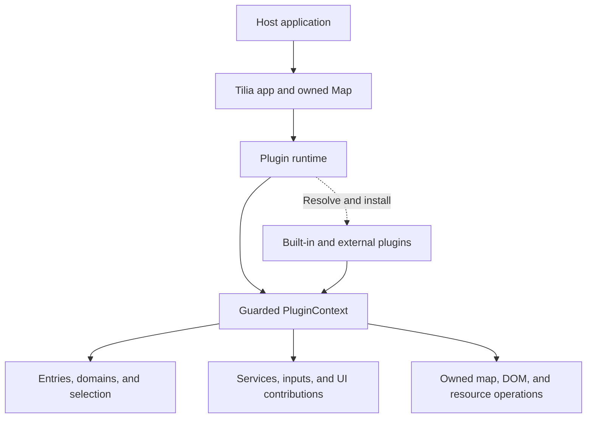
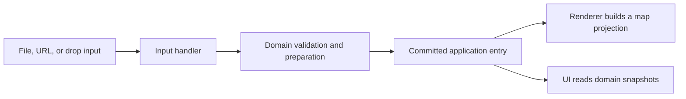

[日本語](ARCHITECTURE.ja.md)

# Tilia architecture

Tilia is an embeddable mapping library with an application runtime and optional plugins. This document explains its current design: which component owns data, how optional features integrate, and what happens when a view, plugin, or application ends. It is intended for developers integrating Tilia or extending it with plugins.

For working examples, start with the [README](../README.md) and [Tilia plugin guide](PLUGINS.md). For plugin implementation patterns and exact application calls, use the [Developing Tilia plugins](PLUGIN-OPERATIONS.md) and [Tilia API reference](API.md). Internal component names below describe responsibilities; they are not additional public APIs.

## Design rationale

Tilia supports small embedded maps as well as viewers and editing tools. Those applications need different combinations of formats, controls, and visualizations. The architecture lets them share consistent data and resource lifetimes while choosing the features they use.

Its central design principle is:

> Core owns mechanisms. Plugins own domain-specific policy and behavior.

Generic mechanisms manage entry identity, selection, dependency ordering, resource ownership, and publication. A domain plugin supplies the meaning of a GPX document or Photo; its input handler knows how to read a file, and its renderer knows how to display it. Generic entry and UI infrastructure does not need to interpret camera metadata or track geometry.

Several choices follow from that principle:

- **Optional features remain optional.** A GPX-only application does not need the JPEG handler's EXIF parser. The catalog exposes lazy loaders; configuring plugins determines which implementations are loaded.
- **Data is authoritative.** Map layers and UI are replaceable views of committed data. Rendering failure or removal does not erase that data.
- **Ownership is explicit.** Every Tilia-managed registration, listener, layer, timer, request, and temporary view has an owner. Plugins must also arrange ownership and cleanup for effects acquired outside those mechanisms. Initialization includes a plan for cleanup, including partial failure.
- **Extension contracts stay specific.** Services, domains, inputs, and UI contributions solve different problems. Plugins integrate through those contracts rather than a universal registry or global event bus.
- **Abstractions serve concrete mapping needs.** Shared mechanisms are justified by uses such as GPX, Photos, editing sessions, and input controls. A format-specific operation does not become generic merely by giving it a generic name.
- **Built-in and external plugins share the model.** Built-ins use guarded contexts, staged registrations, and owned resources too. Application composition and lifecycle coordination remain infrastructure responsibilities.

The result is a plugin system for Tilia's mapping use cases. It does not provide package discovery, dependency version solving, a general scheduler, or a JavaScript security sandbox. Public APIs and configuration are still subject to the project's early-alpha compatibility policy.

## Application and plugin boundaries

Host code creates an app through `createDefaultTiliaApp(container, options)`. The app owns a distinct Leaflet Map, semantic state, registries, and application infrastructure. The host supplies the container and chooses plugin configuration.

The plugin runtime resolves configured definitions, plans hard dependencies, and calls each plugin's `setup(context, options)`. PluginContext provides guarded access to individual mechanisms and gives each plugin a Scope for its resources.

The diagram shows composition and access relationships, not a static import graph:

The composition layer supplies loaders; generic semantic and ownership mechanisms do not import optional plugin implementations to interpret their data. Plugins depend on supported contracts and shared contract keys, rather than another plugin's private implementation.

`app.map` and the plugin's advanced Leaflet access are borrowed access to the app-owned Map. They do not transfer its ownership or grant access to another renderer's private layers. External Map injection is not supported. The exported standalone `createBaseMap` utility is independent of app construction.

## Separate roles within a feature

A feature can consist of several plugins with different responsibilities:

| Role | Responsibility | Example |
| --- | --- | --- |
| Domain | Validate and own semantic data; expose commands, queries, and selection references | `tilia-gpx-domain`, `tilia-photo-domain` |
| Input handler | Recognize and parse files, then create domain entries | `tilia-gpx-input`, `tilia-jpeg-input` |
| Renderer | Project domain snapshots onto the map | `tilia-gpx-renderer`, `tilia-photo-renderer` |
| UI contributor | Supply format-specific layer rows, popup content, and settings | `tilia-gpx-ui`, `tilia-photo-ui` |
| Host or presenter | Arrange contributions or display current selection | `tilia-layers`, `tilia-settings`, `tilia-map-selection-presenter` |
| Tool or overlay | Use domain data while owning independent operation/presentation resources | Track Editor, route search, Milestone |

This separation allows data to exist without a map renderer, a file handler to work without viewer controls, or an editor to keep its own session while the original view changes. Installing one role does not automatically install all the others; the [plugin guide](PLUGINS.md#choosing-plugins) gives concrete combinations.

Base maps have a separate boundary. Their registered definitions, selected tile layer, and selector are map infrastructure, not domain entries or semantic selection targets. They still follow owned registration and resource lifetimes.

## Dependencies and typed extensions

`requires` declares plugin IDs that must be installed before a plugin can operate and remain available during its lifetime. The runtime validates the reachable dependency graph and rejects missing definitions or cycles. Known dependencies install first; an active dependency is reused. The official catalog contains only `tilia-*` IDs. Third-party plugin IDs absent from the application catalog, including IDs reached through `requires`, use the fixed `plugins/<id>/loader.js` convention relative to Tilia’s module location. `x-` means experimental; all non-`tilia-*` IDs are third-party. The sibling `src/` and `plugins/` layout is fixed and the directory is not configurable. Use direct definitions or explicit application catalogs for nonstandard locations; arbitrary packages or URLs are not discovered.

A dependency declaration is distinct from a callable service, a semantic domain, or a UI contribution:

| Mechanism | Meaning |
| --- | --- |
| Dependency | Required plugin availability and installation order |
| Service | A callable contract with one active provider per typed service key |
| Domain | A semantic contract with one active provider per domain key |
| Input | One of multiple file-recognition/handling registrations |
| Contribution | Owned content or behavior for a specific UI host |
| Subscription | A Scope-owned observer of one typed subsystem |
| Resource | A concrete effect owned directly or through a shared-manager lease |

Typed keys identify contracts, independently of plugin IDs. Providers and consumers share the same exported key object. Essential integration uses a hard dependency and required lookup; optional integration uses guarded optional access and targeted availability subscriptions, or a contribution that can wait for its host.

These contracts can share private staging and ownership machinery without sharing a public registry. Their conflict rules differ: a second service provider is invalid, multiple input claimants are expected, and a contribution belongs to a specific host. A universal registry would move these rules into conventions that consumers must interpret.

Removing a dependency is blocked while an active dependent requires it. This constraint is independent of entry-held domain provider leases: entries can block provider removal even when no active plugin requires it. Removing a dependent does not automatically uninstall prerequisites, and a successfully installed prerequisite remains if a later dependent fails. Automatically installed dependencies use default options; configure a prerequisite explicitly first when needed. These installation details are covered in [Developing plugins](PLUGIN-OPERATIONS.md#2-install-the-plugin).

## Installation and publication

Each plugin installation has its own publication boundary:

1. Evaluate unknown external loaders to obtain and validate metadata for the plugin and all reachable dependencies, then plan dependencies. Known catalog implementations resolve after planning.
   Import is separate from setup; arbitrary module-evaluation side effects cannot be rolled back.
2. Create its Scope and PluginContext.
3. Run setup, stage registrations, and own any immediate physical effects.
4. Validate the cleanup return value and preflight the registration batch.
5. Commit registrations and mark the plugin active.
6. Deliver post-commit notifications and callbacks.

Other plugins do not observe half-published registry contributions. Listeners, styles, or DOM can be acquired during setup, so their cleanup must already be owned even before commit. Setup or commit failure rolls back that plugin's effects; it does not create a transaction over the whole dependency graph or arbitrary external effects. An application entry already committed through a domain has its own publication boundary and is not automatically removed by a later setup failure.

Registration publication is synchronous and callback-free; notifications follow the committed state. This prevents reentrant observers from seeing a partially published batch. It is logical publication atomicity, not a promise that arbitrary browser or Leaflet effects are visually atomic.

Post-commit notification failures are isolated and do not reverse committed registrations. `lifecycle.afterCommit` starts work only after the plugin becomes active; its callback must return `void`, not a Promise. Any asynchronous work it starts needs separate ownership and observation.

Concurrent requests for one plugin share installation, and lifecycle changes are serialized. Host code directs installation and removal. Plugins must not call app/runtime installation, removal, or destruction from their setup or cleanup.

## Semantic state and entries

The internal entry store manages application-owned entries through guarded facades. A generic entry snapshot contains `id`, its `domain` key, and whole-entry `visible` state. Labels, geometry, metadata, preferences, and derived values are domain data rather than generic entry fields.

An entry ID is opaque, local to one app, and never reused once reserved. The domain association does not change. Updating data in the same domain preserves entry identity; creating an edited copy or importing a route creates a new entry.

Domain APIs expose immutable snapshots and explicit commands. Revision checks prevent applying a command to data that has changed since it was read. Changes to public domain data or preferences, including GPX child visibility/style and Photo time interpretation, advance the semantic revision; no-ops do not. Photo preview-only resource changes can leave it unchanged. Generic whole-entry visibility is separate and does not advance that revision.

Every in-progress creation and committed entry holds a lease on its exact domain provider. The entry store, not an ordinary service consumer, manages that lease. Explicit provider removal is blocked while leases remain. This prevents persistent entries from losing the implementation needed to interpret or dispose of them.

The creator is not the lifetime owner of a committed entry. An input operation or editing session may end while its successful result remains in the application.

Application ownership and the provider lease solve different problems: imported or saved data must survive removal of its creating tool, while the implementation needed to interpret and release that data must remain available. Provider removal therefore rejects rather than silently deleting user data or leaving entries without their semantic implementation.

### Creation and input

File picker, URL, query, and drop plugins are transports. Installed input handlers claim files; dispatch selects the unique highest-priority claim and rejects a tie. Discovery metadata lets input controls offer the supported extensions and MIME types without knowing their parsers.

An input invocation owns temporary reads and cancellation. Domain creation checks caller, destination, provider, and cancellation authority immediately before publishing the entry. Cancellation before commit prevents publication; cancellation after commit does not roll back the application-owned entry. Dispatch preserves the handler's outcome and cleanup errors rather than promising that any rejected import created no data.

Rendering starts after semantic commit and is not a condition of it. A rendering failure can therefore leave a valid, unrendered entry available to queries, export, or later renderer installation.

### Mutation and removal

A domain command prepares and validates a new snapshot, commits its semantic state/revision, and reconciles selection before rendering catches up. A failure before semantic commit leaves the prior state intact; a rendering or cleanup failure after commit does not reverse the committed change.

Removal first makes an entry logically unavailable and invalidates its selection and presentation authority. It then attempts to close rendering, entry-bound overlays, and domain resources, and publishes the final removal notification after those attempts. The provider lease is released only after the entry Scope closes successfully and no retained update cleanup obligations remain. Scope cleanup includes rendering, bound presentation lifetimes, and provider-instance disposal; a failure in any of these can retain the lease, even if the failed resource is purely visual. Cleanup uses captured handles because public lookup can no longer find the entry.

Cleanup failure does not restore the entry. Remaining obligations and their provider lease are tracked for permitted cleanup attempts. `entries.clear()` removes entries in reverse insertion order, continues after failures, and batches notifications; it is not an all-or-nothing rollback transaction.

## Rendering and currentness

An optional primary renderer interprets a domain snapshot and creates a disposable map projection. There is at most one active primary renderer per domain contract. Removing it withdraws its projections and interactions while the semantic entries remain; reinstalling it builds from current snapshots.

Internally, an application-owned rendering coordinator maintains an entry controller and generations built by the active renderer. A generation owns its layers, bindings, pane leases, and other resources in a dedicated destination-owned lifetime. Its currency depends on the source semantic revision, renderer registration, generation token, and entry/Scope authority.

For replacement, the renderer prepares a candidate, validates it against current state, and activates it while deactivating the previous generation. Consumers never receive a half-built generation as current. This is logical publication atomicity: Leaflet attachment and removal can invoke callbacks and need not form a visually atomic swap. Failure before activation discards the candidate; failure cleaning up the old generation after activation does not roll back the new one.

In-place domain updates are limited to synchronous changes of properties on existing generation-owned resources, with unchanged resource registrations and semantic target mapping. Preparation and preflight must not alter visible resources; commit must be nonthrowing after preflight or reliably rollbackable. Adding or removing resources, changing attachment membership or bindings, or acquiring new effects requires replacement. Whole-entry visibility remains the separate coordinator-managed attachment operation. The current GPX renderer chooses replacement for domain changes.

If data has already advanced, an old generation may only remain as a non-interactive visual fallback or be hidden. It cannot provide current semantic interaction or presentation handles. Rendering status distinguishes `unavailable`, `building`, `active`, and `failed`; availability is separate from the entry's visibility.

That stale fallback is permitted while replacement is being prepared. A definitive failure of the current replacement attempt retires it; toggling visibility must not restore it. A healthy current generation for the same semantic revision and active renderer registration remains `active` after a failed rebuild, with the failure recorded. This is distinct from a stale fallback; matching revision alone does not establish currentness. A superseded attempt only cleans up its own resources and cannot overwrite the newer attempt's state.

Presenters resolve anchors, bounds, and highlights through controlled presentation handles. A handle's `isCurrent()` and `signal` describe its authority. Once invalidated, that handle never revives; renewed presentation requires a fresh resolution. This lets a popup or elevation marker stop using an old projection without accessing the renderer's raw layers.

When a domain can compute geographic bounds from semantic data, fitting the map should use those bounds without requiring a renderer or visible layers. Presentation resolution serves rendered anchors, extents, and highlights; it must not become the authority for semantic geometry. Neither renderer installation nor replacement inherently authorizes a viewport change; that is a caller or feature policy.

## Selection, interaction, and visibility

Global selection contains either no selection or one immutable semantic reference: entry ID, domain key, and a domain-validated reference. It contains no Leaflet layer, popup, DOM node, chart hover state, or editor multi-selection. Callers obtain selection candidates from the relevant domain's selection API.

Physical interactions translate map/UI events into semantic intent. Bindings have explicit lifetimes and precedence: modal, then object, then background. A stale event cannot gain authority through an old generation or Scope.

Interaction Host rechecks binding activity, Scope operational authority, and origin-surface/generation validity before invoking each handler and before starting its action. Explicit binding disposal revokes authority immediately, even if listener cleanup fails or remains pending. Invalidated candidates are skipped; an already consumed decision remains consumed when its action cannot start. Actions that have already started are not retroactively cancelled: asynchronous actions must use their owner's signal and recheck authority after each suspension.

The current [public interaction contract](INTERACTIONS.md) defines surface ownership, dispatch stages, decisions, and Leaflet boundaries for plugin authors. Background is the final unconsumed dispatch stage, including eligible object events that decline; it is not an empty-map hit test. Ordinary plugin bindings attach immediately, whereas renderer bindings are generation-staged. The Host prevents duplicate dispatch of the same event occurrence and suppresses dispatch during controlled publication. These are internal safeguards, not a public gesture or interaction-mode system.

Application composition owns the standard background-click binding in a dedicated application child scope. Through Interaction Host, an unconsumed background click clears Selection Store; with no selection it is a no-op. This binding survives presenter removal and is revoked at application teardown before selection termination. Selection Store owns state and notifications; Map Selection Presenter owns only indicators, popups, and their presentation lifetimes.

Selection and map presentation have different lifetimes:

- Hiding an entry or removing its renderer suppresses its presentation without inherently clearing semantic selection.
- Closing a popup does not clear selection by default.
- Removing an entry or invalidating its selected domain target clears or reconciles the selection.
- Replacing a renderer generation re-resolves presentation; Leaflet object identity is not semantic identity.

Visibility also has separate layers: whole-entry visibility, domain child/category preferences, current renderer availability, and temporary presentation suppression. Editor suppression composes with existing visibility rather than overwriting the user's settings. Releasing it follows the current preferences.

## UI, overlays, and session state

UI hosts own placement, layout, ordering, outer containers, and mount lifetimes. Contributors own behavior and resources within their assigned subtrees. Narrow contributions provide toolbar items, domain layer rows, popup content, and settings. Host-defined groups, rank, and stable IDs determine ordering rather than installation timing.

A contribution can remain registered while its visual host is absent. Hosts close mounted resources when their lifetime ends; optional contributors can become visible again when an appropriate host is available. Hard plugin dependencies still govern whether a host plugin can be removed. Generic layer controls retain visibility/removal and a domain/ID fallback when no format-specific row contribution exists.

Panel state, popup visibility, form input, hover, and editor point selection are local UI/session state. They do not replace authoritative entry data or global semantic selection. A mount or popup failure leaves that semantic state intact.

Plugin overlays read domain snapshots and own independent layers. Milestone labels and elevation highlights do not mutate the GPX renderer's polylines. Entry-bound overlays can bind their child lifetime to entry removal; session overlays can instead follow an editor or request lifetime.

Map resources use ordered bands for base maps, geometry, markers, overlays, selection, and modal/editor presentation, below popup and shell UI. Owned private panes support local placement without arbitrary cross-plugin z-index competition.

Within each band, Tilia-managed private panes and shared band panes stack in the order in which they were first created, with later panes above earlier ones. This keeps their relative order stable across additional leases and reconnection without changing band z-index values or exposing a public numeric `order` option. Replacing a managed pane gives its replacement a new creation position. Tilia does not move or take ownership of standard Leaflet panes or externally owned panes, and does not guarantee stacking order relative to those panes at the same z-index. See [Map, UI, and styles](PLUGIN-OPERATIONS.md#map-ui-and-styles) for the lease and reconnection contract.

The track editor places its draft and its vertex/midpoint handles in separate private panes in the `modal` band, using the vendored library's public `pane` and `handlePane` options, respectively. Drag helper lines retain the library's default placement; this does not establish a general exception for plugin resources.

The vendored `PartiallyEditablePolyline` JavaScript and CSS files in `plugins/x-track-editor/vendor/` must not be modified directly within Tilia. Implement Tilia-specific behavior in the editor integration through the library's public API.

### Examples of independent lifetimes

| Feature | Persistent state | Temporary state |
| --- | --- | --- |
| JPEG input | Photo entry with metadata and saved location | EXIF parsing/input invocation |
| Photo rendering | Domain data and saved inference survive GPX changes | Marker and popup/highlight resources |
| Track Editor | Source entry; Save Copy creates a new entry | Independent draft, editing markers, selection, suppression |
| Route search | Successfully created GPX entries | Form, request, Start/Via/Goal markers |
| Milestone | GPX data remains with its domain | Distance labels tied to the entry and overlay plugin |

Photo inference occurs in the semantic domain, using an available GPX timeline when applicable. Later GPX changes do not silently recompute a saved Photo location; Photo commands can request recomputation.

Track Editor's draft remains independent after initialization. Source changes/deletion or renderer removal do not stop editing or prevent Save Copy. Cancel discards the draft and releases suppression; it does not restore or recreate the source. Saving commits values into a new entry, whose renderer creates new resources. Temporary editor layers are not transferred into persistent entry rendering.

## Ownership, cancellation, and failure

A Scope owns an effect's lifetime. Plugin roots belong to the runtime; child scopes support shorter requests, panels, sessions, and presentations. An entry or renderer generation has its own destination-owned lifetime. Resources do not detach from an owner or transfer between generations. Shared resources such as stylesheets use a manager with separately owned leases.

Closing first revokes operational authority and aborts signals, then performs cancellation, waits for explicitly awaitable work, closes children, and disposes cleanup records. Children close in reverse creation order and local records in reverse registration order; setup-return cleanup runs after children and before local records. Independent cleanup continues after errors, successful records do not repeat, and only declared retry-safe failed records can be attempted again.

Cancellation is cooperative. An AbortSignal requests cancellation; guarded operations and post-await checks prevent stale publication even if the underlying work ignores it. Observing a Promise does not make it cancellable. Resource-specific preparation and disposer handoffs may need to finish before release; arbitrary parsing or detached work does not create a universal shutdown wait barrier.

These boundaries explain different failure outcomes:

| Failure | Result |
| --- | --- |
| Plugin setup/commit | Owned effects roll back; incomplete cleanup can quarantine the ID |
| Input/domain preparation before entry commit | No committed entry; owned preparation cleanup still runs |
| Domain mutation after commit, with cleanup failure | New semantic state remains committed; cleanup obligations are reported |
| Rendering, popup, or UI mount | Committed semantic data and selection remain; affected presentation fails |
| Entry removal cleanup | Entry stays logically absent; unresolved cleanup retains required ownership |
| App destruction cleanup | App stays terminal; independent cleanup is attempted and failures are reported |

A quarantined plugin cannot be replaced through another `use` request. Existing live-app removal paths can attempt permitted safe residual cleanup. These mechanisms do not create a general reset, force-removal, or recovery API. Error and cleanup details are described in [the developer guide](PLUGIN-OPERATIONS.md#7-removal-failure-and-application-destruction).

## Application lifetime and public boundary

`app.ready` completes configured plugin startup. Startup failure initiates cleanup. The host calls `await app.destroy()` when disposing of the component.

Destruction makes the app unusable immediately. Pending publication is fenced, and exact domain providers plus required dependencies are retained while entry or creation cleanup still needs them. Entries and presentations are removed, independent plugin/infrastructure cleanup proceeds, and the app-owned Map's public removal is attempted last. The caller's container and unrelated page resources survive.

Repeated destroy() calls from the host share the same completion Promise, including rejection; they do not automatically retry failed cleanup. The old app cannot be reinitialized; after successful cleanup, a fresh app creates a distinct Map on the surviving container. Cleanup failure does not promise immediate reuse. Destroy does not wait for ready, and ready does not wait for cleanup; an externally initiated destroy rejects pending ready, while an initiating startup failure preserves its original cause.

Application shutdown can revoke operations before every retained provider Scope physically closes. Cleanup must use captured resource handles; cached capabilities or an `alive` check alone cannot authorize new work.

Selection termination emits no final selection event, and rendering termination emits no final rendering-status event. Presentation handles and owner lifetimes supply invalidation. Consumers must close owned effects through those lifetimes rather than wait for a final notification from an already terminated subsystem.

Supported entry points are the exports from `src/index.js`, the documented application facades, and PluginContext capabilities. Internal composition factories, stores, registry engines, provider lease mutation, and render-generation machinery are implementation details. Access to a source file does not make it a supported extension point.

Plugins run as normal page JavaScript. Guarded facades enforce Tilia's lifecycle and data boundaries but cannot sandbox a plugin's raw DOM/network access. Host applications remain responsible for trusted code, external dependencies, and effects they create outside Tilia's owned mechanisms.
